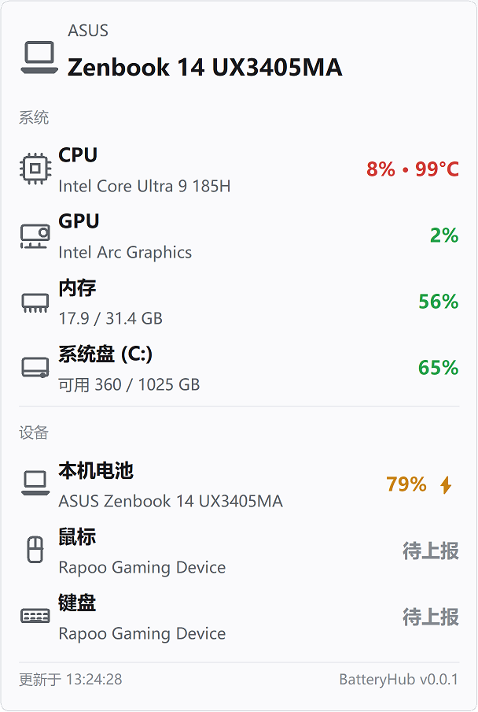

# VitalTray

**English** ｜ [中文](README.md)

[](https://github.com/jd7438716/VitalTray/actions/workflows/ci.yml)
[](LICENSE)

A Windows 10/11 tray tool: **wireless peripheral battery levels + system temperature panel**
(CPU / GPU / disk). Rust + raw Win32, no third-party runtime, MIT.

> **Formerly BatteryHub — renamed to VitalTray on 2026-11-26.** Why we renamed, the candidates we
> compared, and the migration plan: [docs/adr/0004-rename-to-vitaltray.md](docs/adr/0004-rename-to-vitaltray.md).
> This project is **not affiliated** with any same-named project — see [Name and trademark](#name-and-trademark).

> Status: **M0–M9 done.** Left-click the tray icon for the panel (temperatures + device battery),
> right-click for settings (native menu).
> Plan: [PLAN.md](PLAN.md) ｜ Plugin architecture: [docs/adr/0001-plugin-architecture.md](docs/adr/0001-plugin-architecture.md)



> Captured on the author's machine (ASUS Zenbook 14 UX3405MA). CPU temperature, GPU model, disk
> temperature and peripheral battery levels all fit in one panel; anything the drivers do not expose
> shows as “—” instead of a made-up number. **The panel reports temperature, not load** — CPU/GPU
> utilization belongs to Task Manager. (The screenshot shows the Chinese UI; the panel itself follows the
> selected language — see [Languages](#languages).)

## Download and install

Grab `vitaltray.exe` from [Releases](https://github.com/jd7438716/VitalTray/releases) and double-click
it (GUI subsystem — no console window flashes).

- **Verify the download**: each release ships `SHA256SUMS.txt`,
  ```powershell
  Get-FileHash .\vitaltray.exe -Algorithm SHA256
  ```
- **Portable mode**: `vitaltray.exe --portable` — config and logs live next to the exe; no registry writes.
- **Autostart**: writes the per-user `HKCU\Software\Microsoft\Windows\CurrentVersion\Run` key by default;
  no administrator rights needed, and you can turn it off from the tray menu at any time.
- **Uninstall**: right-click the tray icon → Quit; delete the exe; then remove `%LOCALAPPDATA%\VitalTray`
  and the registry value `HKCU\Software\Microsoft\Windows\CurrentVersion\Run\VitalTray`.
- **SmartScreen**: the exe is unsigned, so the first run may show “Windows protected your PC” →
  More info → Run anyway. If that bothers you, verify the SHA256 above.

Current version: **1.2.0** (see [CHANGELOG.md](CHANGELOG.md)).

## Upgrading from BatteryHub

After the rename, the exe, the config directory and the autostart entry all changed names. The tool
**migrates automatically** — nothing to move by hand:

| Item | Old (BatteryHub) | New (VitalTray) | Migration |
|---|---|---|---|
| Executable | `batteryhub.exe` | `vitaltray.exe` | Delete the old exe yourself |
| Config and logs | `%LOCALAPPDATA%\BatteryHub\` | `%LOCALAPPDATA%\VitalTray\` | `config.ini` is copied on first run; **the old directory is kept** |
| Autostart | `Run\BatteryHub` | `Run\VitalTray` | Old value is removed at startup; rewritten under the new name if autostart is enabled |
| Install location | `%LOCALAPPDATA%\Programs\BatteryHub\` | `...\Programs\VitalTray\` | `tools/install.ps1` cleans up the old folder and shortcut |

Portable mode (`--portable`) is not migrated across directories — just copy `VitalTray\config.ini` over.

## Build from source

```powershell
cargo build --release
.\target\release\vitaltray.exe             # start (tray icon only, no panel)
.\target\release\vitaltray.exe --minimized # same, explicitly "minimize to tray" (what autostart uses)
.\target\release\vitaltray.exe --panel     # pop the panel at the cursor (debug/screenshots)
.\target\release\vitaltray.exe --sysmon    # sample temperatures once (also prints load/space) and exit
.\target\release\vitaltray.exe --self-test # headless self-check
```

Handy flags: `--once` (read battery once), `--dump` (list HID devices), `--watch vid:pid` (read-only packet capture),
`--sysmon` (system sampling), `--panel` (pop the panel directly), `--minimized` (stay in the tray, no panel).

## Interaction

- **Left-click the tray icon** → read-only temperature panel: OEM/model + CPU/GPU/disk temperatures +
  device battery levels. It pops up next to the cursor and clamps itself away from screen edges.
- **Status colours**: green = every device >80%; neutral = 20–80%; red = at least one device is at or below
  the low-battery threshold (20% by default); blue = charging; grey = stale reading / no data.
  Details in [docs/status-colors.md](docs/status-colors.md).
- **Right-click the tray icon** → native menu: Refresh now / Open log folder / Autostart / Tray icon on-off /
  Icon style / Debug logging / Language / About / Quit.
- **Hover the tray icon** → the tooltip shows only the title `VitalTray`; battery numbers live in the panel,
  not in the tooltip.
- The panel has **information only, no buttons**: click anywhere, press `Esc`, or click the tray again to
  dismiss it. Right-clicking the panel also dismisses it and hands over the menu (left = look, right = act).
- **Opening it just puts it in the tray**: double-clicking the exe or launching it from the Start menu goes
  straight to the tray — no panel, no window flash, nothing covering your screen. A second double-click
  **does not** start a second process, and the running instance does not pop the panel either
  (the tray icon is right there — left-click it to look).
- **The tray icon is the only menu entry**: if you turn it off from the menu, running `vitaltray.exe` again
  pops the panel; right-clicking the panel brings the menu back (no config editing required).
- **Taskbar text was removed**: per user feedback the tool no longer stuffs text into the taskbar;
  everything lives in the panel.

## Languages

The UI and the command-line output support **10 languages** (English / Simplified Chinese / Traditional
Chinese / Japanese / Korean / German / French / Spanish / Russian / Portuguese-BR).
It **follows the Windows display language** by default; tray right-click → Language switches at any time
(immediately effective), or set `[ui] lang=auto` (default) or `en` / `zh-CN` / `ja` … in `config.ini`.

The panel picks a font per language (YaHei / Yu Gothic UI / Malgun Gothic / Segoe UI), and the exe's
“file description” follows the system language too. These fonts are **referenced by name only — no font
files are bundled or redistributed** (see [docs/licenses.md](docs/licenses.md) §6).
Details and how to add a language: [docs/i18n.md](docs/i18n.md).

## What the panel shows (and where the data comes from)

The panel answers “**is it hot?**”, not “is it busy?” — utilization (CPU/GPU/memory/disk I/O) is
Task Manager's job.

| Item | Content | Source (all user-mode, no admin) |
|---|---|---|
| CPU | temperature °C | PDH `Thermal Zone Information(*)\High Precision Temperature` (ACPI thermal zone, 0.1 K) |
| GPU | model + temperature °C | D3DKMT adapter enumeration (`KMTQAITYPE_ADAPTERREGISTRYINFO` / `_ADAPTERPERFDATA`) |
| Disk | temperature °C + free/total | `IOCTL_STORAGE_QUERY_PROPERTY` reads the NVMe SMART/Health log page (composite temperature); `GetWindowsDirectoryW` + `GetDiskFreeSpaceExW` |
| Brand / model | OEM brand, system model, CPU model | `HKLM\HARDWARE\DESCRIPTION\System\BIOS` / `CentralProcessor\0` |
| Peripheral battery | mouse / keyboard / headset… + brand and model | plugins (system battery, Bluetooth DEVPKEY, HID++, Rapoo…) |

**About temperatures**: each of the three readings depends on hardware/drivers; if a value is unavailable
the panel shows “—” and never invents a number.

- **CPU**: the ACPI thermal zone exposed by firmware. Its calibration is up to the firmware, and some
  machines read high all the time (this one often sits at 85–100 °C).
- **GPU**: depends on whether the driver reports temperature in `KMTQAITYPE_ADAPTERPERFDATA`
  (common for NVIDIA/AMD; **Intel iGPUs usually report 0**, so this machine's Intel Arc shows “—”).
  Integrated GPUs have no other user-mode temperature source.
- **Disk**: the NVMe SMART composite temperature, readable via a protocol-specific query — **no admin
  required**. Note that the `Get-StorageReliabilityCounter` path *does* need admin; don't confuse the two.
  SATA/mechanical disks or old drivers simply show “—”.
- **Memory**: not shown — soldered memory has no temperature sensor, and memory usage doesn't belong here.

**We don't and wouldn't** install a kernel driver or require elevation just to read numbers.

## Layout

```text
crates/bh-api      plugin API (platform-free; plugins depend only on it)
crates/bh-core     host: config / logging / single instance / autostart / tray / panel / system sampling / message loop
crates/bh-app      executable entry (build.rs compiles icon / version info / manifest into the exe)
plugins/           device-domain plugins: mouse / keyboard / laptop / bluetooth
assets/            vitaltray.ico (nine sizes, 16–256; same source as the tray fallback icon)
docs/adr/          architecture decision records
tools/check-size.ps1       file-size gate (fails above 400 lines)
tools/check-exe.ps1        resource gate (fails when icon / version info / manifest is missing)
tools/gen-notices.ps1      third-party notice generator and checker
tools/check-cleanroom.ps1  clean-room gate (fails when GPL/upstream markers leak into sources)
```

Panel code structure (`crates/bh-core/src/panel/`):

```text
mod.rs      window lifetime, show/hide, messages, hit-testing and keyboard
window.rs   creating the window, DPI, positioning at the cursor, clamping to the work area
model.rs    content model (text + semantic colours), no pixels
layout.rs   vertical layout and hit rectangles
paint.rs    2× supersampled GDI drawing + per-pixel alpha
icons.rs    every icon, drawn from lines / circles / polygons
gdi.rs      small drawing helpers
theme.rs    light/dark theme colours
```

System sampling lives in `crates/bh-core/src/sysmon/` (its own thread every 2 s; the UI only reads snapshots).

Localization lives in `crates/bh-core/src/i18n/` (`ui/` for the interface, `cli/` for command-line text,
one file per language; see [docs/i18n.md](docs/i18n.md) to add one).

## Plugin model

A plugin = a **device domain** (mouse / keyboard / laptop / headsets, gamepads, phones later), one crate per domain:

```rust
impl DeviceDomain for Domain {
    fn glyph(&self) -> Glyph { Glyph::Mouse }
    fn matches(&self, d: &DeviceInfo) -> Match { /* ... */ }
    fn read(&self, d: &DeviceInfo, io: &mut dyn HidIo) -> Result<Reading, DriverError> { /* ... */ }
}
```

Adding a domain = a new crate + one line in `domains()` in `crates/bh-core/src/plugins.rs`.
Vendor protocols are not plugins; they live in protocol crates shared by several domains.

## Config and autostart

- Config: `%LOCALAPPDATA%\VitalTray\config.ini` (next to the exe with `--portable`).
- Autostart: writes `HKCU\Software\Microsoft\Windows\CurrentVersion\Run`, never HKLM, no admin;
  toggle it from the menu at any time; `--no-autostart` means "don't touch the registry this run".
- The panel follows the current system light/dark theme; on multi-monitor setups it uses the DPI and work
  area of the monitor under the cursor.
- Startup behaviour: `[system] start_minimized=1` (default) = tray icon only; set it to `0` to have the
  panel open at launch. `--minimized` forces the tray-only start (that is what the autostart entry uses),
  `--panel` is the debug switch that forces the panel.
- UI language: `[ui] lang=auto` (default, follows Windows) or `en` / `zh-CN` / `zh-TW` / `ja` / `ko` /
  `de` / `fr` / `es` / `ru` / `pt-BR`; tray right-click → Language also works (immediately effective),
  see [docs/i18n.md](docs/i18n.md).
- Command line: `--no-tray`, `--no-capture`, `--portable`, `--config <path>`, `--debug`, `--self-test`,
  `--sysmon`, `--panel`, `--minimized`.

## Logging

- Location: `%LOCALAPPDATA%\VitalTray\app.log` (next to the exe in portable mode).
- Format: `2026-11-23T22:47:49.283+08:00 [INFO ] [poll] -> [laptop:78%, mouse:86%]`
- Levels: `error < warn < info < debug < trace`, default `info`.
- Switch: `--log-level debug` or “tray right-click → Debug logging (verbose)”, which writes back to the config.
- Rotation: 1 MB per file, 3 historical files kept.
- Troubleshooting: the “Open log folder” menu item gets you there in one click.
- Development notes: [DEVLOG.md](DEVLOG.md).

## Discipline

- One file ≤ 400 lines (`tools/check-size.ps1`, enforced by CI).
- The exe must carry an icon / version info / application manifest (`tools/check-exe.ps1`, run by CI and
  release). We once shipped an exe with none of them — Explorer showed the generic white-window icon and
  the property page was blank.
- Clean room: we only take protocol facts, never copy GPL code (see PLAN.md §2).
  `tools/check-cleanroom.ps1` scans sources for GPL/upstream markers (run by CI); with the upstream clones
  kept in `research/` locally it also compares comments and string literals verbatim.
- If a temperature/load value is unavailable, show “—” — never guess.

## Roadmap

- **M0 ✅** skeleton / tray / menu / autostart / plugin framework
- **M1 ✅** HID enumeration / system battery / Bluetooth / Logitech HID++ / polling
- **M2 ✅** taskbar text widget (**removed in M7**)
- **M3 ✅** history / runtime estimates / low-battery notifications
- **M4 ✅** i18n (Chinese / English) / installer / more drivers
- **M9 ✅** localization: 10 languages + automatic system-language detection + menu switching
  (`lang=auto`, see [docs/i18n.md](docs/i18n.md))
- **M5 ✅** Rapoo proprietary protocol, verified on real hardware
- **M6 ✅** levelled development logging
- **M7 ✅** vertical status panel: CPU/GPU/memory/disk/temperatures, brand and model, icons, menu-driven interaction
- **v1.0.0 ✅** first public release (2026-11-26), see [CHANGELOG.md](CHANGELOG.md)
- **v1.2.0 ✅** (2026-11-26) 10 languages + rename to VitalTray + automatic migration of config/autostart
  ([ADR 0004](docs/adr/0004-rename-to-vitaltray.md))
- **TODO**: Logitech receiver multi-device pairing table; calibration wizard UI; disk SMART temperature
  (needs admin, deliberately not done).

## License

MIT (see [LICENSE](LICENSE)).

- Third-party projects we read, their licenses, and the licenses we elect: [docs/licenses.md](docs/licenses.md)
- License strategy (why MIT holds up here, and where its limits are): [docs/adr/0003-license-strategy.md](docs/adr/0003-license-strategy.md)
- Full text of third-party licenses shipped inside the exe: [THIRD-PARTY-NOTICES.txt](THIRD-PARTY-NOTICES.txt)
  (generated from `Cargo.lock` by `tools/gen-notices.ps1`; CI checks it is up to date)

### Name and trademark

- **VitalTray is unrelated to any same-named project.** It is not an official version, derivative or branch
  of anything, and no third-party trademarks, icons, text or screenshots are used. The former project name
  "BatteryHub" appears only to explain the history (see [ADR 0004](docs/adr/0004-rename-to-vitaltray.md)).
- **MIT grants no trademark rights** (neither does the GPL): the open-source license covers the code only and
  is not a trademark license for the name "VitalTray". If you redistribute this project or ship it on a store,
  please use your own name and icon to avoid confusing users.
- The name was checked for collisions before the rename (GitHub repository counts, web search); the evidence
  and date are recorded in [ADR 0004](docs/adr/0004-rename-to-vitaltray.md). If you spot a naming conflict,
  please open an issue and we will address it.
