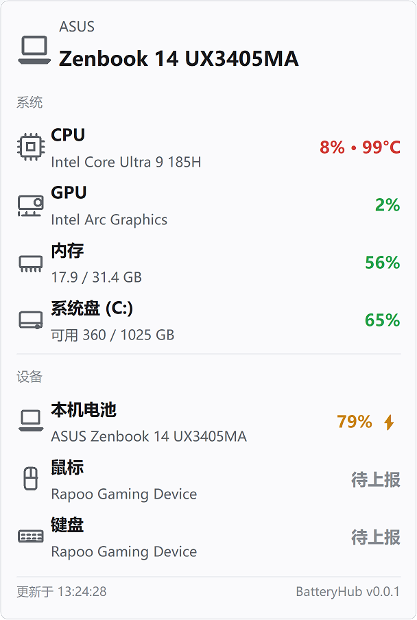

# VitalTray

**中文** ｜ [English](README.en.md)

[](https://github.com/jd7438716/VitalTray/actions/workflows/ci.yml)
[](LICENSE)

Windows 10/11 托盘工具：**无线外设电量 + 整机温度面板**（CPU / GPU / 硬盘温度）。
Rust + 原生 Win32，零第三方运行时，MIT。

> **原名 BatteryHub（→ 2026-11-26 更名 VitalTray）**。改名原因、候选对比与迁移方案：
> [docs/adr/0004-rename-to-vitaltray.md](docs/adr/0004-rename-to-vitaltray.md)。
> 本项目与任何同名项目**无关联**，详见[名称与商标](#名称与商标)。

> 状态：**M0–M9 完成**。左键托盘看面板（温度 + 设备电量），右键托盘做设置（原生菜单）。
> 计划书：[PLAN.md](PLAN.md) ｜ 插件架构决策：[docs/adr/0001-plugin-architecture.md](docs/adr/0001-plugin-architecture.md)



> 本机实拍：ASUS Zenbook 14 UX3405MA。CPU 温度、GPU 型号、硬盘温度、外设电量与品牌/型号一屏可见；
> 驱动不提供的温度显示 “—”，不编造数字。**面板只报温度不报占用**——占用百分比归任务管理器。

## 下载与安装

到 [Releases](https://github.com/jd7438716/VitalTray/releases) 下载 `vitaltray.exe`，双击即可运行
（GUI 子系统，不会弹黑窗）。

- **校验下载**：发布页 `SHA256SUMS.txt` 里有哈希，
  ```powershell
  Get-FileHash .\vitaltray.exe -Algorithm SHA256
  ```
- **便携模式**：`vitaltray.exe --portable` —— 配置与日志放 exe 同目录，不写注册表。
- **开机自启**：默认写用户级 `HKCU\Software\Microsoft\Windows\CurrentVersion\Run`，不需要管理员；
  右键托盘可随时关掉。
- **卸载**：右键托盘 → 退出；删掉 exe；再删 `%LOCALAPPDATA%\VitalTray` 与注册表值
  `HKCU\Software\Microsoft\Windows\CurrentVersion\Run\VitalTray`。
- **SmartScreen**：exe 未签名，首次运行可能提示「Windows 已保护你的电脑」→ 更多信息 → 仍要运行；
  介意的话用上面的 SHA256 自行核对。

当前版本：**1.2.1**（变更见 [CHANGELOG.md](CHANGELOG.md)）。

## 从 BatteryHub 升级

更名后 exe、配置目录与自启项都换了名字，工具会**自动迁移**，不用手动搬：

| 项 | 旧（BatteryHub） | 新（VitalTray） | 迁移方式 |
|---|---|---|---|
| 可执行文件 | `batteryhub.exe` | `vitaltray.exe` | 旧 exe 自行删除 |
| 配置与日志 | `%LOCALAPPDATA%\BatteryHub\` | `%LOCALAPPDATA%\VitalTray\` | 首次启动自动复制 `config.ini`，**旧目录保留不删** |
| 开机自启 | `Run\BatteryHub` | `Run\VitalTray` | 启动时清掉旧值；若配置里自启为开，按新名重写 |
| 安装位置 | `%LOCALAPPDATA%\Programs\BatteryHub\` | `...\Programs\VitalTray\` | `tools/install.ps1` 会清理旧目录与旧快捷方式 |

便携模式（`--portable`）不做跨目录迁移，把 `VitalTray\config.ini` 复制过去即可。

## 从源码构建

```powershell
cargo build --release
.\target\release\vitaltray.exe             # 启动（只出现托盘图标，不弹面板）
.\target\release\vitaltray.exe --minimized # 同上，显式要求“最小化到托盘”（开机自启用的就是这条）
.\target\release\vitaltray.exe --panel     # 启动后直接在鼠标位置弹出面板（调试/截图）
.\target\release\vitaltray.exe --sysmon    # 采样一次温度（顺带打印占用/空间，排障用）并打印
.\target\release\vitaltray.exe --self-test # 无界面自检
```

常用命令：`--once`（读一次电量）、`--dump`（列 HID 设备）、`--watch vid:pid`（只读抓报文）、
`--sysmon`（系统状态采样）、`--panel`（直接弹面板）、`--minimized`（只驻留托盘，不弹面板）。

## 交互

- **左键托盘图标** → 只读温度面板：品牌型号 + CPU/GPU/硬盘温度 + 设备电量，
  贴着鼠标弹出、自动避开屏幕边缘。
- **状态色**：绿 = 所有设备 >80%；中性 = 20–80%；红 = 任一设备 ≤ 低电阈值（默认 20%）；
  蓝 = 充电中；灰 = 上次读数 / 无数据。细则见 [docs/status-colors.md](docs/status-colors.md)。
- **右键托盘图标** → 原生菜单做功能：立即刷新 / 打开日志目录 / 开机自启 / 托盘图标开关 /
  图标样式 / 调试日志 / 语言 / 关于 / 退出。
- **鼠标悬停托盘图标** → 提示只显示标题 `VitalTray`；电量、续航都在左键面板里，提示不重复数字。
- 面板里**只有信息、没有按钮**：点任意处、按 `Esc`、再点一次托盘 → 收起；
  在面板上按右键也是收起面板、把菜单交出来（左键=看，右键=做，两边不混）。
- **打开 = 只在托盘里**：双击 exe / 开始菜单启动都直接进托盘，不弹面板、不闪窗，不会挡住屏幕上的东西。
  第二次双击 exe **不会**再起一个进程，已经在跑的那个也不弹面板（托盘图标就在那儿，左键即看）。
- **托盘图标是唯一的菜单入口**：菜单里关掉它之后，再运行一次 `vitaltray.exe` 就会弹出面板，
  在面板上右键即可把菜单拿回来（不用去改配置文件）。
- **任务栏文本已移除**：按用户反馈，不再往任务栏里塞文字；所有信息进面板。

## 语言

界面与命令行支持 **10 种语言**（英 / 简中 / 繁中 / 日 / 韩 / 德 / 法 / 西 / 俄 / 葡-BR），
**默认跟随 Windows 的界面语言**；托盘右键 → 语言 可随时手动切换（立即生效），
也可以在 `config.ini` 里写 `[ui] lang=auto`（默认）或 `en` / `zh-CN` / `ja` 等。

面板按语言挑字体（YaHei / Yu Gothic UI / Malgun Gothic / Segoe UI），exe 的「文件说明」
也按系统语言显示。这几个字体**只按名字引用系统自带版本，不打包、不分发字体文件**
（见 [docs/licenses.md](docs/licenses.md) §6）。细则与“加一种语言”的步骤见 [docs/i18n.md](docs/i18n.md)。

## 显示内容与数据来源

面板只回答“**热不热**”，不回答“忙不忙”——占用率（CPU/GPU/内存/磁盘 I/O）交给任务管理器。

| 项目 | 内容 | 来源（全部用户态、无需管理员） |
|---|---|---|
| CPU | 温度 °C | PDH `Thermal Zone Information(*)\High Precision Temperature`（ACPI 热区，0.1 K） |
| GPU | 型号 + 温度 °C | D3DKMT 枚举适配器（`KMTQAITYPE_ADAPTERREGISTRYINFO` / `_ADAPTERPERFDATA`） |
| 硬盘 | 温度 °C + 可用/总量 | `IOCTL_STORAGE_QUERY_PROPERTY` 读 NVMe SMART/Health log page（复合温度）；`GetWindowsDirectoryW` + `GetDiskFreeSpaceExW` |
| 品牌 / 型号 | OEM 品牌、整机型号、CPU 型号 | `HKLM\HARDWARE\DESCRIPTION\System\BIOS` / `CentralProcessor\0` |
| 外设电量 | 鼠标 / 键盘 / 耳机… + 品牌型号 | 插件（本机电源、蓝牙 DEVPKEY、HID++、Rapoo…） |

**关于温度**：三路读数各自依赖硬件/驱动，拿不到就显示 “—”，绝不编造。

- **CPU**：固件暴露的 ACPI 热区。口径由固件决定，有的机型常年偏高（本机就常在 85–100 °C）。
- **GPU**：看驱动是否在 `KMTQAITYPE_ADAPTERPERFDATA` 里上报温度（NVIDIA/AMD 常见；**Intel 核显多为 0**，
  本机 Intel Arc 就是 “—”）。核显没有别的用户态温度源。
- **硬盘**：NVMe 的 SMART 复合温度，走协议专有查询即可读到，**不需要管理员**。
  注意 `Get-StorageReliabilityCounter` 那条路是要管理员的，别混为一谈；SATA/机械盘或老驱动读不到就是 “—”。
- **内存**：不显示——板载内存没有温度传感器，内存占用也不归这个面板。

**不做也不建议**为了读数装内核驱动或提权。

## 目录

```text
crates/bh-api      插件 API（不依赖平台，插件只依赖它）
crates/bh-core     宿主：配置 / 日志 / 单实例 / 自启 / 托盘 / 面板 / 系统采样 / 消息循环
crates/bh-app      可执行入口（build.rs 把图标 / 版本信息 / 应用清单编进 exe）
plugins/           设备域插件：mouse / keyboard / laptop / bluetooth
assets/            vitaltray.ico（16–256 九档，exe 图标与托盘兜底图标同源）
docs/adr/          架构决策记录
tools/check-size.ps1   文件大小门禁（>400 行失败）
tools/check-exe.ps1    资源门禁（缺图标 / 版本信息 / 清单即失败）
tools/gen-notices.ps1  第三方许可清单生成与校验
tools/check-cleanroom.ps1  洁净室门禁（源码里混进 GPL/上游标识即失败）
```

面板代码结构（`crates/bh-core/src/panel/`）：

```text
mod.rs      窗口生命周期、显隐、消息、命中与键盘
window.rs   建窗、DPI、贴鼠标摆位、夹回工作区
model.rs    内容模型（文字 + 语义色），不含像素
layout.rs   竖排布局与命中矩形
paint.rs    2× 超采样 GDI 绘制 + 逐像素 alpha
icons.rs    线段/圆/多边形画的所有图标
gdi.rs      纯绘制小工具
theme.rs    明暗主题配色
```

系统采样在 `crates/bh-core/src/sysmon/`（独立线程每 2 秒一次，UI 只读快照）。

多语言在 `crates/bh-core/src/i18n/`（`ui/` 界面文案、`cli/` 命令行文案，一个语言一个文件；加语言见 [docs/i18n.md](docs/i18n.md)）。

## 插件模型

插件 = **设备域**（鼠标 / 键盘 / 笔记本 / 以后的耳机、手柄、手机），一个域一个 crate：

```rust
impl DeviceDomain for Domain {
    fn glyph(&self) -> Glyph { Glyph::Mouse }
    fn matches(&self, d: &DeviceInfo) -> Match { /* ... */ }
    fn read(&self, d: &DeviceInfo, io: &mut dyn HidIo) -> Result<Reading, DriverError> { /* ... */ }
}
```

加一个域 = 新建 crate + 在 `crates/bh-core/src/plugins.rs` 的 `domains()` 里加一行。
品牌协议不单独做插件，放在协议库 crate 里给多个域复用。

## 配置与自启

- 配置：`%LOCALAPPDATA%\VitalTray\config.ini`（`--portable` 时放 exe 同目录）。
- 自启：默认写 `HKCU\Software\Microsoft\Windows\CurrentVersion\Run`，不碰 HKLM、不要管理员；
  菜单里可随时开关；`--no-autostart` 表示本次不改注册表。
- 面板自动读取当前系统明暗主题；多显示器时按鼠标所在显示器的 DPI 与工作区摆位。
- 启动行为：`[system] start_minimized=1`（默认）＝启动后只驻留托盘；改成 `0` 才是“启动就把面板弹出来”。
  `--minimized` 强制最小化（开机自启项带的就是它），`--panel` 是调试用的强制弹出。
- 界面语言：`[ui] lang=auto`（默认，跟随 Windows）或 `en` / `zh-CN` / `zh-TW` / `ja` / `ko` / `de` / `fr` / `es` / `ru` / `pt-BR`；
  托盘右键 → 语言 也能改（立即生效），见 [docs/i18n.md](docs/i18n.md)。
- 命令行：`--no-tray`、`--no-capture`、`--portable`、`--config <path>`、`--debug`、`--self-test`、`--sysmon`、`--panel`、`--minimized`。

## 日志（开发日志功能）

- 位置：`%LOCALAPPDATA%\VitalTray\app.log`（便携模式在 exe 同目录）。
- 格式：`2026-11-23T22:47:49.283+08:00 [INFO ] [poll] -> [laptop:78%, mouse:86%]`
- 级别：`error < warn < info < debug < trace`，默认 `info`。
- 切换：`--log-level debug` 或「右键托盘 → 调试日志（详细）」，会写回配置。
- 滚动：单文件 1 MB，保留 3 个历史文件。
- 排障：菜单「打开日志目录」一秒定位。
- 开发过程记录见 [DEVLOG.md](DEVLOG.md)。

## 纪律

- 单文件 ≤ 400 行（`tools/check-size.ps1`，CI 会跑）。
- exe 必须带图标 / 版本信息 / 应用清单（`tools/check-exe.ps1`，CI 与 release 都会跑）。
  曾经把三样全缺的 exe 发上了 Releases——资源管理器里是通用白窗图标，属性页一片空白。
- 洁净室：只参考协议事实，不复制任何 GPL 代码（见 PLAN.md 第 2 节）。
  `tools/check-cleanroom.ps1` 会扫出源码里混进来的 GPL/上游标识（CI 跑）；
  本地若保留 `research/` 下的上游 clone，还会做「注释/字符串逐字重合」比对。
- 温度/占用拿不到就显示 “—”，不猜数字。

## 路线

- **M0 ✅** 骨架 / 托盘 / 菜单 / 自启 / 插件框架
- **M1 ✅** HID 枚举 / 本机电池 / 蓝牙 / Logitech HID++ / 轮询
- **M2 ✅** 任务栏文本 widget（**M7 已下线**）
- **M3 ✅** 历史 / 续航估算 / 低电通知
- **M4 ✅** i18n（中 / 英）/ 安装包 / 更多驱动
- **M9 ✅** 多语言：10 种语言 + 跟随系统自动识别 + 菜单切换（`lang=auto`，见 [docs/i18n.md](docs/i18n.md)）
- **M5 ✅** Rapoo 私有协议实测接入
- **M6 ✅** 分级开发日志
- **M7 ✅** 竖排状态面板：CPU/GPU/内存/磁盘/温度、品牌型号、图标、菜单式交互
- **v1.0.0 ✅** 首个公开版本（2026-11-26），见 [CHANGELOG.md](CHANGELOG.md)
- **v1.2.0 ✅**（2026-11-26）10 种语言 + 产品更名 VitalTray + 旧配置/自启项自动迁移（[ADR 0004](docs/adr/0004-rename-to-vitaltray.md)）
- **v1.2.1 ✅**（2026-11-26）打开只驻留托盘：启动与二次打开都不再弹面板（[CHANGELOG.md](CHANGELOG.md)）
- **待办**：Logitech 接收器多设备配对表；校准向导 UI；磁盘 SMART 温度（需要管理员，暂不做）。

## 许可

MIT（见 [LICENSE](LICENSE)）。

- 参考过的开源项目、各自许可与本项目的许可选举：[docs/licenses.md](docs/licenses.md)
- 许可策略（为什么 MIT 站得住、边界在哪）：[docs/adr/0003-license-strategy.md](docs/adr/0003-license-strategy.md)
- 随 exe 分发的第三方许可全文：[THIRD-PARTY-NOTICES.txt](THIRD-PARTY-NOTICES.txt)
  （由 `tools/gen-notices.ps1` 从 `Cargo.lock` 生成，CI 校验未过期）

### 名称与商标

- **VitalTray 与任何同名项目无关**，不是任何项目的官方版本、衍生版或分支；作者也未使用他人的
  商标、图标、文案或截图。历史项目名 "BatteryHub" 仅用于说明来历（更名记录见
  [ADR 0004](docs/adr/0004-rename-to-vitaltray.md)）。
- **MIT 不授予商标权**（GPL 亦然）：本项目的开源许可只覆盖代码本身，不构成对 "VitalTray"
  这一名称的商标许可。若要基于本项目做二次分发/上架，请换用自己的名称与图标，避免用户混淆。
- 名称在更名前做过同名检索（GitHub 同名仓库数、Web 检索），证据与日期记录在
  [ADR 0004](docs/adr/0004-rename-to-vitaltray.md)；如发现名称冲突请开 issue，我们会处理。
