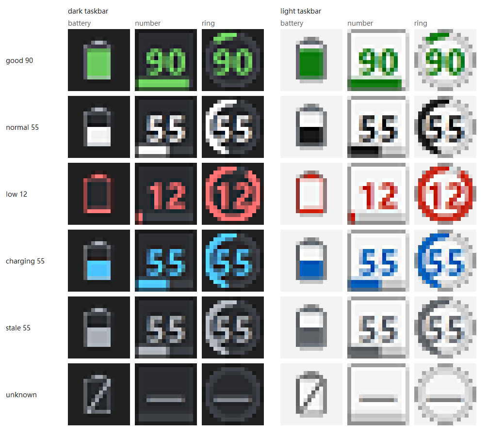

# 状态色：托盘图标与面板的电量语义

> 一句话：**颜色只回答“要不要管”**——绿 = 都充足，蓝 = 在充电，中性 = 正常，红 = 有低电，
> 灰 = 上次读数 / 没数据。颜色不表达“这是哪台设备”，也不承担唯一的识别线索。



## 为什么改

1. 原来的分档是 `≤15% 红 / ≤40% 琥珀 / 其余绿`，和低电提醒阈值（配置 `low_battery`，默认 20%）
   对不上：提醒响了、图标还是琥珀。
2. 面板和托盘各有一套颜色：面板里“充电中”是琥珀，托盘里是蓝；同一件事两种颜色。
3. 托盘图标读的是**应用**主题（`AppsUseLightTheme`），但它画在**任务栏**上。应用浅色 + 任务栏深色时
   图标会画反。
4. 多设备时没有定义“一台 85%、一台 15%”该显示什么颜色；没有读数时画成 0%，和真的没电分不清。

## 规则

### 单台设备

| 状态 | 条件 | 颜色 | 非颜色线索 |
|---|---|---|---|
| 充足 `Good` | 电量 **> 80%** | 绿 | 长填充 / 弧长 / 数字 |
| 正常 `Normal` | 20–80%，未充电 | 中性（黑/白） | 中等填充 |
| 低电 `Low` | 电量 **<= 低电阈值**（默认 20%） | 红 | 短填充 + **整壳变红** |
| 充电 `Charging` | 20–80%，正在充电 | 蓝 | 面板里带 `⚡` |
| 上次 `Stale` | 只有上次读数 | 灰 | 面板里带 `· 上次` |
| 无数据 `Unknown` | 没有可读设备 | 灰 | 电池画斜线、数字/圆环画 `—` |

低电优先于充电：15% 插着电也先红，充过阈值才变蓝。充足优先于充电：都 >80% 时插着电也保持绿
（用户规则：所有设备都超过 80% 是一个颜色）。

### 汇总（托盘只画一个图标）

按“最需要关注”的顺序取：

1. 没有可读设备 → **无数据**（灰，斜线 / `—`）
2. 有新鲜读数，且任一台 `<= 低电阈值` → **低电**（红）
3. 全部新鲜读数 `> 80%` → **充足**（绿）
4. 有设备在充电 → **充电**（蓝）
5. 其余 → **正常**（中性）
6. 没有新鲜读数、但还有上次读数 → **上次**（灰）

“新鲜”= 本轮读到了、且不处于“上次读数”状态。汇总显示的电量 = 新鲜读数里的最低值；
没有新鲜读数时 = 上次读数里的最低值。这样“所有设备都 >80%”一定显示绿，“任何一台低电”一定显示红。

## 色板

| token | 深色任务栏 | 浅色任务栏 | 对任务栏底色对比度 | 用途 |
|---|---|---|---|---|
| Good | `#6CCB5F` | `#107C10` | 8.03 : 1 / 4.84 : 1 | 充足、全部 >80% |
| Normal | `#F2F2F2` | `#1A1A1A` | 14.55 : 1 / 15.68 : 1 | 正常（跟随主题前景） |
| Low | `#FF6B6B` | `#C42B1C` | 5.87 : 1 / 5.10 : 1 | 低电 |
| Charging | `#4CC2FF` | `#005FB8` | 8.12 : 1 / 5.68 : 1 | 充电中 |
| Stale | `#A9AEB5` | `#5F6368` | 7.30 : 1 / 5.45 : 1 | 上次读数 |
| Unknown | `#8F959C` | `#767676` | 5.39 : 1 / 4.09 : 1 | 无数据 |

对比度背景：深色任务栏 `#202020`、浅色任务栏 `#F3F3F3`。全部 ≥ 4.09:1，
高于 WCAG 2.2 非文本对比度 3:1 的要求；这组数字由 `status.rs` 的单测锁死，改色改到不达标会红。

## 几个刻意的决定

### 1. 中间档（20–80%）不上色

Windows 11、Android、macOS 的电池图标都是同一个思路：**正常状态保持中性，只有异常才上色**。
如果 50% 也上琥珀色，那“琥珀”就不再是警告，用户会习惯性忽略它。
所以这里把颜色留给真正需要抬头的状态；面板里仍然有数字和填充高度。

> 备选：如果希望 20–80% 也有颜色，只改 `status::state_color(State::Normal, _)` 一处。
> 不推荐把它做成琥珀——那会让一半的使用时间都在“告警”。

### 2. 充电用蓝，不用 Windows 的绿

Windows 11 的新电池图标用绿表示“正在充电且状态良好”。但本工具里绿已经被“所有设备都 >80%”占用，
再用绿会让“充足”和“在充”混在一起。蓝还额外占一个便宜：对红绿色觉障碍（deuteranopia/protanopia）
最安全——蓝通道不受影响。

### 3. 低电时整枚图标变红

低电时电池填充只剩一两个像素，16px 下几乎看不见。所以 `Low` 状态下**外壳（电池轮廓）也跟着变红**，
保证“一眼红”。数字/圆环样式本身有彩色数字，不受影响。

### 4. 无数据 ≠ 0%

“还没读到”和“真的没电”是两件事：前者画空心 + 斜线（数字/圆环画 `—`），后者是红色低电。
启动后的第一秒、设备没上报时，不会再看到一个“0% 的电池”。

### 5. 任务栏主题和应用主题分开读

托盘图标跟 `SystemUsesLightTheme`，面板跟 `AppsUseLightTheme`。两者可以不同，
主题不一致时各走各的，不再互相串色。

## 可访问性

- **不只靠颜色**：填充高度、圆环弧长、底部进度条、数字本身都在编码电量；无数据有斜线/`—`；
  面板里充电行带 `⚡`。
- **色弱**：蓝与绿/红在蓝通道上可分；绿/红在浅色主题下亮度接近，色弱用户主要靠填充长度和数字区分，
  这正是“颜色不是唯一线索”的设计。
- **对比度**：所有状态色对任务栏底色 ≥ 4.09:1，单测锁定。

## 调参入口

| 想改什么 | 改哪里 |
|---|---|
| “充足”线 80% | `crates/bh-core/src/status.rs` 的 `GOOD_ABOVE` |
| 低电阈值 | 配置 `[system] low_battery`（默认 20；同时驱动低电提醒和红色） |
| 某个状态的颜色 | `status::state_color` |
| 中间档也上色 | `state_color` 里 `State::Normal` 的两个值 |

## 实现落点

| 文件 | 职责 |
|---|---|
| `crates/bh-core/src/status.rs` | 状态枚举、阈值、汇总优先级、状态色、对比度单测 |
| `crates/bh-core/src/tray/icons.rs` | 按状态画图标（竖向电池，电量从底部往上填）；低电红壳；无数据斜线/`—` |
| `crates/bh-core/src/runtime.rs` | 读数 → `status::aggregate` → 托盘图标 |
| `crates/bh-core/src/theme.rs` | 任务栏主题 `taskbar_is_dark()`（`SystemUsesLightTheme`） |
| `crates/bh-core/src/panel/model.rs` | 面板设备行套用同一套状态与阈值 |
| `crates/bh-core/src/panel/theme.rs` | 面板色板复用 `status::state_color` |
| `crates/bh-core/examples/icons.rs` | 6 状态 × 3 样式 × 明暗的预览矩阵 |

## 验证

```powershell
cargo test --all-targets                 # 阈值 / 汇总优先级 / 对比度
cargo run --example icons -- tmp/status-icons.bmp   # 生成上面的矩阵图
```

实机：面板里本机电池 `79% ⚡` 显示蓝色（充电中）；托盘图标同色；
鼠标/键盘“待上报”显示灰色。截图见 `tmp/panel-status.png`、`tmp/tray-zoom.png`。

## 参考

- [Windows 11 Insider Preview Build 26120.3000：电池图标配色](https://blogs.windows.com/windows-insider/2025/01/24/announcing-windows-11-insider-preview-build-26120-3000-dev-channel/)
  —— 绿 = 充电且状态良好，黄 = 节能模式（≤20%），红 = 危急，正常为中性色。
- [Android 15 新电池图标](https://www.androidpolice.com/android-new-battery-icon-up-close-look/)
  —— 绿 = 充电，黄 = 省电模式，红 = ≤20%，平时白色。
- [WCAG 2.2 · 1.4.11 Non-text Contrast](https://www.w3.org/WAI/WCAG22/Understanding/non-text-contrast.html)
  —— 图标等非文本内容与相邻颜色至少 3:1。
